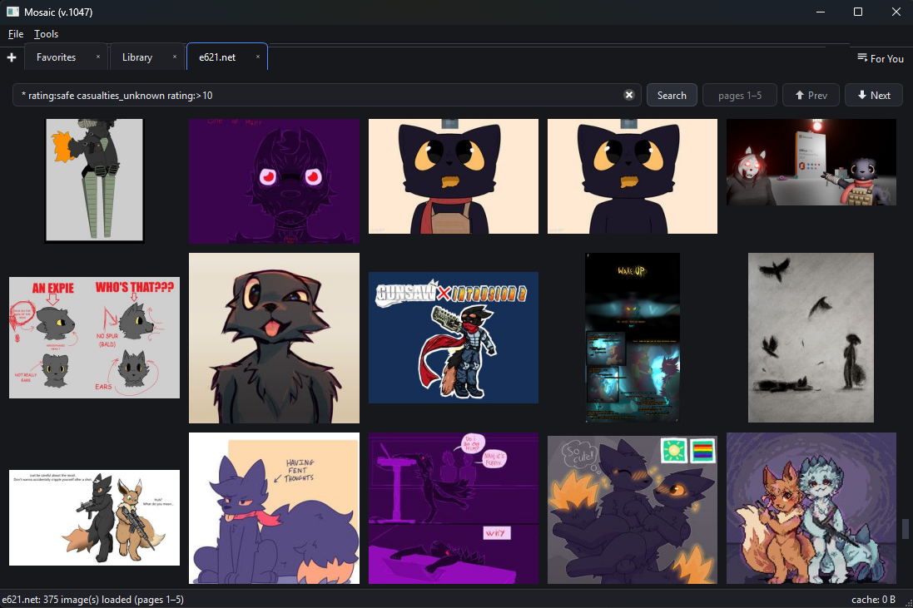
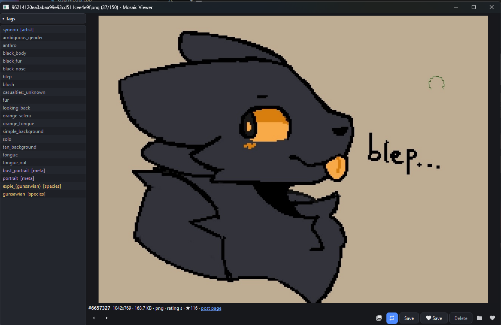
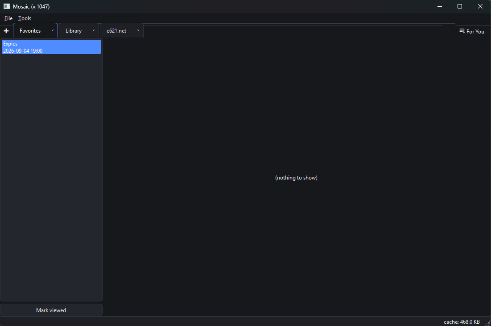

# Mosaic

Browse and download from boards like alongside your own
local library. Search by tag, get a feed tuned to your taste, and keep
everything organized — including near-duplicate cleanup.

Inspired by [imgbrd-grabber](https://github.com/Bionus/imgbrd-grabber), but
simpler and built around a local, searchable library.

---

## Features

- **Tabbed browser** — one tab per source, or an "All sources" tab that
  searches several sites at once. Tag search with autocomplete and
  infinite-scroll thumbnails.
- **Standalone viewer** — flip between posts with ← / →, walk the
  parent/child chain with ↑ / ↓, scrub video frame-by-frame, save with a
  keystroke.

  

- **"For You" feed** — a vertical feed of recommended posts that learns from
  every like, save, and skip, with an **Explore** slider for how often it
  tries new tangents.
- **Local catalog** — tags, favorites, and metadata for your own library.
- **Duplicate detection** — find near-identical images and resolve them in
  one click.
- **Tag tools** — merge similar tags, resolve conflicts, filter from a
  sidebar.
- **Fast** — GPU-accelerated rendering, background prefetching, and full
  video/animated post playback.

  

---

## Building

See the **[build guide](src/README.md)** for prerequisites and commands.

| | |
|---|---|
| **Platform** | Windows (x64) |
| **Media** | Images and video |
| **Built with** | C++20 - Qt 6 - CMake |

## Keybinds

### Main window

| Key | Action |
|---|---|
| `Ctrl+Q` | Quit |
| `Ctrl+Shift+T` | Reopen closed tab |
| `F11` | Maximize / restore window |

### Viewer

| Key | Action |
|---|---|
| `←` / `→` | Previous / next post |
| `↑` / `↓` | Parent / child in the post chain |
| `Space` | Play / pause |
| `F11` | Toggle fullscreen |
| `F5` | Toggle slideshow |
| `,` / `.` | Scrub video back / forward one frame (`Shift` = 10 frames) |
| `<` / `>` | Scrub video back / forward one frame |
| `Ctrl+S` | Save to library (add `Shift` to also favorite) |
| `Ctrl+C` | Copy media |
| `Esc` | Close (closes loupe first if open) |
| `Ctrl+Q` | Close viewer |

### Feed ("For You")

| Key | Action |
|---|---|
| `Space` / `→` | Next post |
| `←` / `Backspace` | Previous post |
| `L` | Like and advance |
| `D` | Dislike and advance |
| `Ctrl+S` | Save to library and advance |
| `F12` | Toggle debug info |

The **Explore** slider next to the action buttons sets how adventurous the
feed is: further left sticks to what you already like, further right spends
more of each batch on tangents (new tags and looks the feed is unsure about).

The debug sidebar (`F12`) shows the learned model's progress (how much of the
ranking it controls, its accuracy against the heuristic, learned likes and
dislikes, upcoming tangents) and has **Dropped images** (why the funnel rejected posts)
and **Liked posts**, which opens every liked/saved post in the viewer. Liked
posts are paged in as you walk toward the end of the loaded list, so a profile
with thousands of likes never loads all at once.

---
